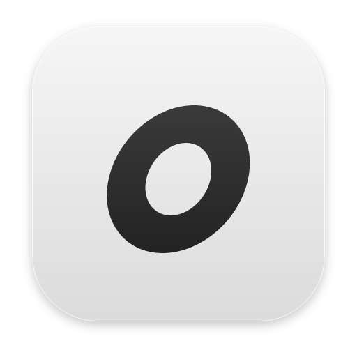

> **OMP Desktop** is based on [vastsa/PI-Desktop v0.18.0](https://github.com/vastsa/PI-Desktop/tree/v0.18.0),
> modified to use [oh-my-pi (`omp`)](https://github.com/can1357/oh-my-pi) as its only agent engine.
> The original **LGPL-3.0** license and upstream attribution are preserved; see [LICENSE](LICENSE) and [NOTICE](NOTICE).
> Corresponding public source, including the OMP Desktop modifications: [Emmeet/PI-Desktop](https://github.com/Emmeet/PI-Desktop/tree/feat/omp-support).
> See [Running with omp](#running-with-omp-oh-my-pi). Upstream releases linked elsewhere below are not OMP Desktop builds.

<div align="center">



# OMP Desktop

### A modular desktop workspace for AI agents

**Bring projects, agents, models, plugins, and workflows into one persistent desktop environment.**

Local-first · Model-agnostic · Plugin-powered · macOS / Windows / Linux

<br />

[](https://github.com/Emmeet/PI-Desktop/tree/feat/omp-support)
[](LICENSE)

<br />

**[Build OMP Desktop](#running-with-omp-oh-my-pi)** ·
[Upstream documentation](https://pi-docs.aiuo.net/) ·
[Build a Plugin](docs/plugin-development.md) ·
[Screenshots](docs/guide/screenshots.md) ·
[简体中文](README.zh-CN.md)

<br />


<br />

**Your projects stay local · Your models stay replaceable · Your workspace stays yours**

</div>

> **Current release line: 0.18.x (Early Preview).**

---

## Why OMP Desktop?

Terminal agents are great at execution. IDE agents are great at living inside an editor.

OMP Desktop builds on PI-Desktop's workspace:

> **Give AI agents a persistent, independent, and extensible desktop workspace of their own.**

<table>
<tr>

<td width="25%" valign="top">

### Independent Workspace

No dependency on a specific IDE or terminal.

Projects, sessions, reviews, previews, and agents all live in their own workspace.

</td>

<td width="25%" valign="top">

### Plugin-Powered

Plugins extend more than the agent.

Add panels, views, widgets, tools, MCP servers, themes, and background services.

</td>

<td width="25%" valign="top">

### Agent Orchestration

One agent is not always enough.

Delegate to Subagents or coordinate full Worker Sessions in parallel.

</td>

<td width="25%" valign="top">

### Model Freedom

Cloud models, local models, custom gateways, compatible APIs.

Switch models without rebuilding your workflow.

</td>

</tr>
</table>

<div align="center">

**It is not a wrapper around one model. It is not another IDE extension.**

### It is a desktop platform for agent workflows.

</div>

---

## Plugins are part of the workspace, not an afterthought

PI-Desktop keeps the Core focused.

**Your actual workflow is assembled through extensions.**

<table>
<tr>

<td width="33%" valign="top">

### Agent

Extend what the agent can do

**Agent Tools**
**Skills**
**Completion**
**pi Extensions**

</td>

<td width="33%" valign="top">

### Workspace

Extend the desktop itself

**Commands**
**Panels**
**Work Panel Views**
**Floating Widgets**
**Themes**

</td>

<td width="33%" valign="top">

### Platform

Extend the runtime

**MCP Servers**
**Resident Services**
**Plugin Message Bus**

</td>

</tr>
</table>

A plugin does not have to be “just another tool.”

It can be an entire product:

```text
Voice Agent
├── Floating Widget
├── Speech Service
├── Agent Tool
└── Commands

GitHub Workspace
├── Work Panel
├── MCP Server
├── Agent Tools
└── Background Service

Session Analytics
├── Dashboard
├── Commands
└── Workspace View
```

### What can a plugin add?

| Capability          | What it enables                                                |
| ------------------- | -------------------------------------------------------------- |
| **Command**         | Add actions to the global command system                       |
| **Panel**           | Open a standalone plugin interface                             |
| **Floating Widget** | Build voice orbs, status lights, timers, and other floating UI |
| **Work Panel View** | Add new views to the right-side workspace                      |
| **Agent Tool**      | Register tools callable by the agent                           |
| **Completion**      | Use the models already configured by the user                  |
| **Skill**           | Add reusable agent capabilities and workflows                  |
| **Theme**           | Customize workspace appearance                                 |
| **MCP Server**      | Connect local or remote MCP servers                            |
| **Service**         | Run persistent background work                                 |
| **Message Bus**     | Let plugins communicate with each other                        |

Plugins can be distributed as `.piplug` packages or installed through the marketplace.

<div align="center">

### [Build your first plugin →](docs/plugin-development.md)

</div>

---

## One foundation, many workflows

```text
                         PI-Desktop
                             │
          ┌──────────────────┼──────────────────┐
          │                  │                  │
        Agent            Workspace           Platform
          │                  │                  │
     Agent Tools           Panels              MCP
       Skills             Widgets            Services
     Subagents             Views            Message Bus
   pi Extensions          Themes
          │                  │                  │
          └──────────────────┼──────────────────┘
                             │
                       Your Workflow
```

PI-Desktop can simply be your coding agent.

Or you can turn it into:

**AI Development Workspace · Voice Agent · DevOps Console · GitHub Workspace · Data Assistant · Multi-Agent Control Center · Automation Platform**

> **The Core provides the foundation. Plugins decide what your workspace becomes.**

---

## Three ways to work

<table>
<tr>

<td width="33%" valign="top">

### Agent

**Give it a task. Let it work.**

Read code, edit files, run commands, test, and iterate.

Best for day-to-day development.

</td>

<td width="33%" valign="top">

### Plan

**Review the approach before execution.**

The agent studies the project first and produces an implementation plan.

Best for refactors and high-risk changes.

</td>

<td width="33%" valign="top">

### Goal

**Define the outcome. Let the agent choose the path.**

Lock the objective and acceptance criteria, then let the agent drive execution.

Best for complex and long-running tasks.

</td>

</tr>
</table>

Privileged operations still pass through PI-Desktop's permission layer.

---

## When one agent is not enough

Complex work should not be forced into one context window.

PI-Desktop provides two levels of delegation.

### Subagents

Delegate independent work to background agents:

**Code exploration · Implementation · Test analysis · Research · Review**

Each Subagent gets its own context and reports the result back to the parent agent.

### Session Orchestrator

For longer-lived work, delegate to full Worker Sessions.

```text
Main Session
│
├── Worker A
│   └── Frontend
│
├── Worker B
│   └── Backend
│
├── Worker C
│   └── Tests
│
└── Worker D
    └── Review
```

Workers are full PI-Desktop sessions:

**Independent context · Independent execution · Directly inspectable · Reusable · Full transcript**

<table>
<tr>

<td width="50%">


<p align="center"><sub>Coordinate multiple Worker Sessions from one parent Session</sub></p>

</td>

<td width="50%">


<p align="center"><sub>Each Worker remains a full, inspectable Session</sub></p>

</td>

</tr>
</table>

<div align="center">

**Move from “one agent helps me code” to “multiple agents divide and complete the work.”**

</div>

---

## Built for work that lasts

PI-Desktop is organized around:

<div align="center">

### Project → Session → Agent → Work

</div>

—not around disposable chat threads.

You can:

* Manage multiple projects and sessions
* Pin, archive, branch, and search sessions
* Queue prompts while an agent is already running
* Reference project files with `@`
* Use slash commands
* Review diffs
* Inspect command output
* Work with the right-side Work Panel
* Keep streaming checkpoints
* Recover interrupted work whenever possible

**A Session can continue across multiple app launches.**

---

## See what the agent is doing

<table>
<tr>

<td width="50%">


<p align="center"><sub>Persistent Sessions instead of disposable chats</sub></p>

</td>

<td width="50%">


<p align="center"><sub>Switch models and reasoning levels inside the Session</sub></p>

</td>

</tr>

<tr>

<td width="50%">


<p align="center"><sub>A plugin marketplace that extends both the agent and the desktop</sub></p>

</td>

<td width="50%">


<p align="center"><sub>Connect your own provider, gateway, or local model</sub></p>

</td>

</tr>
</table>

<div align="center">

**[Explore more screenshots →](docs/guide/screenshots.md)**

</div>

---

## Swap the model, keep the workflow

PI-Desktop does not tie your workflow to a single model vendor.

Use:

**OpenAI · Anthropic · OpenAI-Compatible APIs · Custom Gateways · Ollama · LM Studio · Local Models**

Configure each model independently:

**Provider · Model ID · Context Window · Output Limit · Reasoning / Thinking · Temperature · OAuth · API Key · Endpoint**

Different Sessions can use different models.

The same Session can switch models at any time.

```text
Planning     → Model A
Coding       → Model B
Review       → Model C
Private Task → Local Model
```

> **The model is a replaceable component of the workflow — not the workflow itself.**

---

## Already using another coding agent?

Keep your existing work.

PI-Desktop can import local sessions from:

**Claude Code · Codex · OpenCode · Pi**

---

## Local-first

PI-Desktop does not require you to move your development environment into our cloud.

| Data                 | Default behavior                          |
| -------------------- | ----------------------------------------- |
| Projects             | Local                                     |
| Sessions             | Local                                     |
| Settings             | Local                                     |
| Logs                 | Local                                     |
| API credentials      | OS Keychain                               |
| PI-Desktop telemetry | None                                      |
| Model requests       | Sent directly to your configured provider |

**No mandatory PI-Desktop account.**

**No mandatory PI-Desktop relay.**

When using a remote model, the context required for the request is sent directly to that provider.

---

## You control the permissions

Agents can read files, edit code, run commands, call tools, use extensions, and delegate work.

Privileged operations still pass through the permission layer:

```text
Agent
  ↓
Tool Request
  ↓
Permission Layer
  ↓
Allow / Ask / Deny
  ↓
Execution
```

**You decide how much autonomy each Session gets.**

---

## Get started

<table>
<tr>

<td width="25%" valign="top">

### 01

**Download**

Install PI-Desktop

</td>

<td width="25%" valign="top">

### 02

**Connect a model**

Configure a Provider

</td>

<td width="25%" valign="top">

### 03

**Open a project**

Choose a local repository

</td>

<td width="25%" valign="top">

### 04

**Start working**

Agent / Plan / Goal

</td>

</tr>
</table>

<div align="center">

### [Download PI-Desktop →](https://github.com/vastsa/PI-Desktop/releases/latest)

**macOS · Windows · Linux**

</div>

### Packages

| Platform | Architecture  | Package                                 |
| -------- | ------------- | --------------------------------------- |
| macOS    | Apple Silicon | `.dmg` / `.zip`                         |
| macOS    | Intel         | `.dmg` / `.zip`                         |
| Windows  | x64           | Installer / `.zip`                      |
| Linux    | x64 / ARM64   | `.AppImage` / `.deb` / `.rpm` / `.asar` |

macOS releases are signed with a Developer ID certificate and notarized by Apple.

<details>
<summary><strong>Linux Compatibility</strong></summary>

<br />

Linux packages require **glibc 2.35+**.

Common supported distributions include:

* Ubuntu 22.04+
* Debian 12+
* Fedora 36+

Check your current version with:

```bash
ldd --version
```

</details>

---

## Built on Pi

PI-Desktop is built on the [pi](https://github.com/badlogic/pi-mono) ecosystem.

The Agent Runtime uses:

* `pi-ai`
* `pi-agent-core`
* `pi-coding-agent`

> **Pi provides the Agent Engine. PI-Desktop builds the persistent desktop workspace, sessions, permissions, plugins, and agent orchestration around it.**

---

## For Developers

PI-Desktop can also serve as a host platform for building agent products.

You can build:

**Plugins · MCP Servers · Skills · Agent Tools · pi Extensions · Themes · Panels · Floating Widgets · Background Services**

### Plugin quick start

Built-in templates include:

* `panel-basic`
* `agent-tool-basic`
* `skill-pack`
* `full-demo`

Plugins can be created and loaded directly as Development Plugins.

**[Plugin Development Guide →](docs/plugin-development.md)**

### Run from source

<details>
<summary><strong>Development Setup</strong></summary>

<br />

#### Requirements

* Node.js `>=22.19`
* pnpm `>=10`
* Stable Rust Toolchain

#### Start

```bash
git clone https://github.com/vastsa/PI-Desktop.git
cd PI-Desktop

pnpm install

cargo build -p host-core
pnpm build:js

pnpm dev
```

#### Validate

```bash
pnpm typecheck
pnpm lint
pnpm test
```

</details>

### Documentation

[Documentation](https://pi-docs.aiuo.net/) ·
[Architecture](docs/spec/02-architecture/01-architecture.md) ·
[Specification](docs/spec/README.md) ·
[Plugin Development](docs/plugin-development.md) ·
[E2E Test Plan](docs/spec/06-delivery/04-e2e-test-plan.md) ·
[Release Runbook](docs/spec/06-delivery/06-release-runbook.md) ·
[AGENTS.md](AGENTS.md)

---

## Contributing

Contributions are welcome:

**Issues · Pull Requests · Plugins · Skills · MCP Integrations · Documentation · Translations**

For standalone capabilities, consider one question first:

> **Would this be better as a Plugin?**

Keep the Core focused. Let the ecosystem grow.

**[Report an Issue](https://github.com/vastsa/PI-Desktop/issues/new/choose)** ·
[Open Issues](https://github.com/vastsa/PI-Desktop/issues) ·
[Build a Plugin](docs/plugin-development.md)

---

## Project Trend

<div align="center">

<a href="https://trendshift.io/repositories/178787?utm_source=repository-badge&amp;utm_medium=badge&amp;utm_campaign=badge-repository-178787">

</a>

</div>

---

## Friends

[Linux.Do](https://linux.do/) — A new ideal community

---

## Model Acknowledgements

> **Not by a lone genius, but by a token-powered construction crew.**

PI-Desktop has been built with the help of models from multiple providers.

More than **27 billion tokens** have been used across development, refactoring, review, design, and debugging.

Thanks to every human contributor — and every model that helped us build it.

---

## License

OMP Desktop preserves PI-Desktop's **GNU Lesser General Public License v3.0 (LGPL-3.0)**.
It is based on **vastsa/PI-Desktop v0.18.0**, with OMP Desktop modifications maintained in the
[public source fork](https://github.com/Emmeet/PI-Desktop/tree/feat/omp-support).
See [LICENSE](LICENSE) and [NOTICE](NOTICE). Distributors must provide the corresponding source
for the exact binary revision and preserve the upstream license and notices.

---

<div align="center">


## PI-Desktop

### Build your own Agent workspace.

**Your models · Your agents · Your plugins · Your workspace**

<br />

**[Download](https://github.com/vastsa/PI-Desktop/releases/latest)** ·
[Documentation](https://pi-docs.aiuo.net/) ·
[Build a Plugin](docs/plugin-development.md)

<br /><br />

<sub>Local-first · Model-agnostic · Plugin-powered</sub>

</div>


## Running with omp (oh-my-pi)

This fork drives the [`omp`](https://github.com/can1357/oh-my-pi) CLI as its
only agent engine. Each chat runs in its own `omp --mode rpc` process, and the
app shows omp's streaming output and tool calls. omp keeps its own sessions,
models, and credentials; the app never reads omp's secrets.

### 1. Install omp

```bash
curl -fsSL https://bun.sh/install | bash        # Bun, if you don't have it
bun install -g @oh-my-pi/pi-coding-agent@18     # stable >=18.10.0 <19.0.0
omp --version
```

Then set up a model the way omp normally does: run `omp` once in a terminal and
log in (`/login`), or export a provider API key, or define providers in
`~/.omp/agent/models.yml`. If plain `omp` can chat in a terminal, the desktop
app can use the same setup. Startup also checks the stable OMP 18 version range
and RPC protocol version 1; incompatible versions fail with recovery guidance.

### 2. Build and run the app from source

```bash
git clone -b feat/omp-support https://github.com/Emmeet/PI-Desktop.git
cd PI-Desktop
pnpm install
pnpm build:js
cargo build -p host-core          # needs a recent stable Rust (1.88+)
pnpm dev                          # or: cd apps/desktop && pnpm build && npx electron .
```

Or use the launcher, which builds anything missing and starts the app:

```bash
scripts/run-omp-desktop.sh
```

Only a disposable source-development container that cannot support Chromium's
sandbox may explicitly set `OMP_DESKTOP_NO_SANDBOX=1`. The launcher rejects
production/installed use; packaged OMP Desktop never reads this variable.
Do not use it for Windows installation or ordinary desktop launches.

### How it works

- **New chat** creates an omp session in the chosen project folder. The first
  message starts `omp --mode rpc --cwd <project>`.
- **Existing omp sessions** from `~/.omp/agent/sessions` show in the sidebar
  with an `OMP` badge. Opening one and sending a message resumes it with
  `omp --resume <file>`.
- **Stop** sends omp's `abort` command.
- **Model picker** (composer, bottom right) lists the models omp reports
  through `get_available_models`, which come from your `models.yml` and logins.
  Choosing one calls omp's `set_model` on the open chat and is used for new chats.
  The reasoning slider calls `set_thinking_level`. The last choice is saved in
  `~/.config/omp-desktop/preferences.json` and survives restarts.
- **Role switcher** (`@role`, next to the model picker) applies an omp model
  role's model to the chat. **Settings → Models** manages omp roles: assign the
  built-in roles (`default`, `smol`, `slow`, `plan`, `commit`, …), or create and
  delete custom ones. Roles are stored by omp itself (`modelRoles` in
  `~/.omp/agent/config.yml`), written through `omp config set`.
- **Attachments**: images are sent to omp as images. Other files are passed by
  their path, so omp can read them.
- **Edit and Regenerate** use omp's `branch`. omp writes the rewound
  conversation to a new session file, and the app hides the old file.
- **Fork** uses omp's `fork`. **Rename** uses `set_session_name`. **Delete**
  asks for confirmation, then removes the session's `.jsonl` file (only inside
  omp's sessions folder) and its artifacts folder.
- **Conversation actions** open Goal, BTW, Handoff, Loop, and Share panels. Goal
  follows OMP's lifecycle and token budget. BTW restores side-question history
  and can be cancelled. Handoff compacts this same conversation. Loop repeats
  the chosen prompt 1–50 times, stops on failure/abort, and is owned by the
  runtime rather than the selected tab.
- **Share** saves OMP's HTML export locally, including a separate escaped
  appendix for Desktop-only slash-command output. Open, reveal, and copy the
  saved path explicitly; nothing uploads automatically.
- **Native tools** provide primary-screen capture, file/URL opening, and text
  clipboard access through OMP host-tool/URI requests. Each operation asks for
  explicit native consent. Cancelling a request or disposing its session stops
  pending work; it does not grant future access.
- **File mentions**: type `@` and select a project file. The input shows an
  atomic chip, while OMP receives the exact path (quoted when it contains spaces).
  Switching sessions never keeps a stale project's suggestion list.
- **Settings → OMP preferences** controls OMP themes, local word completion,
  cache warming, slow defaults, LSP, Git and commit settings. Optional theme
  accent linkage follows Light/Dark/System without replacing the app layout.
  Cache warming may cost tokens; OMP next-message prediction is distinct from
  the local `predict_word` completion shown in the input.
- **Windows and hotkeys**: Mod+Shift+N opens another chat window; Alt+Shift+O
  focuses a chat globally. OMP bindings include Ctrl+P/Ctrl+Shift+P model cycling,
  Shift+Tab thinking cycling, Alt+M model selection, F5 retry and Escape interrupt.
  Customize them in Shortcuts. Menus, dialogs and IME retain their own keys.
- Models, logins, tools, extensions, and compaction all come from omp itself.
- **Tool approvals** default to `write` in desktop settings. Choose `always-ask`,
  `write` or `yolo` for the next reply without changing global omp approval mode.
  Existing per-tool rules remain shared with omp; native host tools still require
  their separate explicit desktop consent.
- **Crash recovery** retries after 250 ms, 1 s and 4 s, resuming the same saved
  session and retaining queued work. An uncertain in-flight message is never
  replayed automatically; inspect history before resending. After exhaustion,
  the existing Continue action retries a fresh connection with the queue retained.
- **Context usage** defaults to used capacity across the ring, tooltip, details
  and accessibility label. Explicit remaining-capacity preferences stay unchanged.
  Exact OMP `provider/model` context metadata wins over a reported session window.
- **Provider onboarding** checks OMP's available models and links to Accounts &
  subscriptions; embedded-provider rows do not falsely hide setup guidance.

### Environment variables

| Variable | Purpose |
| --- | --- |
| `PI_DESKTOP_OMP_BIN` | Full path to the `omp` executable. Without it the app searches `PATH` and usual Bun/local locations. Windows checks `omp.exe` / `omp.cmd`, `%USERPROFILE%\.bun\bin`, `%APPDATA%\npm` and `%LOCALAPPDATA%\pnpm`. |
| `PI_DESKTOP_OMP_AGENT_DIR` | Use a different omp agent directory (default `~/.omp/agent`, or `PI_CODING_AGENT_DIR`). |
| `PI_DESKTOP_OMP_MODEL` | Optional default `provider/model` for new chats. It is used only until you pick a model in the app. |
| `PI_DESKTOP_OMP_PREFS` | Path to the app's preferences file (default `~/.config/omp-desktop/preferences.json`). |
| `PI_DESKTOP_LEGACY_PI_ENGINE=1` | Restore the original embedded-pi behavior (unsupported in this fork). |

If `omp` can't be found, sending a message fails with an `OMP_NOT_FOUND`
error that includes these install instructions.

### Current limitations

- OMP Live Voice / STT / TTS integration is not included in this P2 change.
- Desktop plugin panels and browser ownership remain attached to the primary
  window; secondary chat windows do not bypass their security boundary.
- After a reload, images in older messages show as file chips rather than
  inline previews.
- Edit and Regenerate leave the earlier session file on disk. The app hides it
  through its preferences file; omp still has it.
- The Rust host service still starts for settings and projects, and the
  embedded pi packages are still in the dependency tree, but they are not used
  to run agents.

### OMP Desktop P2 changes

- Added local HTML sharing, goal/BTW/handoff/finite loops, native host tools,
  OMP preference/theme linkage, configurable hotkeys and independent chat windows.
- Preserved slash-command output across conversation reopening and restart
  without adding it to model context; excluded private authentication/config copy.
- Removed orphan/nested subagent rows through spawning-tool ownership, while
  preserving genuine cancelled zero-tool agents.
- Replaced the MCP menu's timed second-click removal with explicit confirmation
  and retryable errors. Completed OMP copy in all nine shipped languages.

### OMP Desktop readiness changes (unreleased)

- Isolated OMP host roots (`~/.omp-desktop` / `~/.omp-desktop-dev`) and Electron
  identities (`OMP-Desktop` / `OMP-Desktop Dev`) prevent shared locks/databases
  with upstream. Close PI-Desktop before first launch: a fresh managed OMP profile
  may import a verified read-only copy of upstream host/browser state. Existing
  OMP profiles and explicit root/profile overrides are never overwritten; upstream
  stays intact for manual recovery. See the [storage contract](docs/spec/03-runtime/04-data-storage.md#omp-first-start-import).
- Added native Windows x64 artifact-only CI and package verification; NSIS,
  Portable EXE and ZIP use distinct names. Packages carry LICENSE and NOTICE.
  Cross-platform/mismatched-architecture packaging is rejected. The workflow is
  dispatch-only, creates no release and needs GitHub workflow registration before
  dispatch. Native Windows execution remains a separately recorded qualification,
  not a claim inferred from Linux checks. See the [Windows lane](docs/spec/06-delivery/06-release-runbook.md#omp-desktop-windows-artifact-only-lane).
- Added desktop-only safer approval defaults, stable OMP version/protocol checks,
  bounded crash recovery with preserved queue and no uncertain-message replay.
- Tightened production CSP to a hashed static import map/local plugin modules,
  removed arbitrary loopback connectivity, and enforced registered main-frame IPC
  ownership plus separate invoke/event allowlists. Renderer extensions remain
  trusted in-process code and must come from trusted sources.
- Corrected default context-use display and model-window selection; improved
  keyboard task creation, visible required-name guidance, five-second delete
  confirmation and OMP-based provider onboarding. Settings navigation uses explicit
  non-draggable controls and coordinate/scroll regression scenarios.
- Filled genuine missing German, Spanish, French, Korean, Brazilian Portuguese
  and Turkish copy, with localized recovery/setup messages in all nine catalogs.
  Repaired the ADR catalog and English/Chinese OMP spec/scenario mirrors.
- Automatic updates stay opt-in, binaries remain unsigned, and voice work is
  excluded. Live StepFun roles/features, physical screenshot/global-key delivery
  and real provider authorization must be recorded separately from fixture tests.

